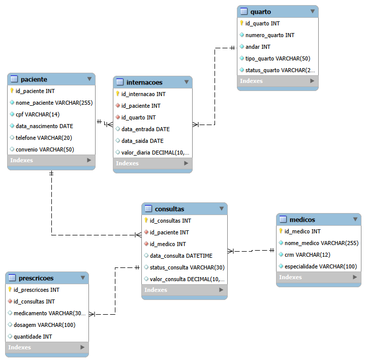

# Sistema de Gestão Hospitalar Vida & Saúde

Sistema de banco de dados relacional desenvolvido para gerenciamento operacional de estabelecimentos hospitalares, controle de pacientes, corpo médico, acomodações, internações, consultas ambulatoriais e prescrições medicamentosas.

---

## Sumário

* [Sobre o Projeto](#sobre-o-projeto)
* [Objetivo do Sistema](#objetivo-do-sistema)
* [Regras de Negócio e Requisitos](#regras-de-negócio-e-requisitos)
* [Tecnologias Utilizadas](#tecnologias-utilizadas)
* [Modelagem Relacional (Diagrama EER)](#modelagem-relacional-diagrama-eer)
* [Estrutura do Banco de Dados](#estrutura-do-banco-de-dados)
* [Dicionário de Dados](#dicionário-de-dados)
* [Consultas SQL Implementadas (DQL)](#consultas-sql-implementadas-dql)
* [Backup e Restauração de Dados (Dump)](#backup-e-restauração-de-dados-dump)
* [Como Executar o Projeto](#como-executar-o-projeto)

---

## Sobre o Projeto

O **Hospital Database System** é uma solução completa de modelagem e implementação de banco de dados relacional desenvolvida para a gestão integrada do Hospital Vida & Saúde. O projeto engloba desde a conceituação das regras de negócio até a normalização de dados (da 1FN à 3FN), criação dos esquemas (DDL), povoamento de dados de teste com 10 registros por tabela (DML), elaboração de consultas analíticas e estratégias de backup via linha de comando.

---

## Objetivo do Sistema

* **Automação do Cadastro Geral:** Gerenciamento centralizado de prontuários de pacientes e registro detalhado do corpo médico credenciado.
* **Gestão de Acomodações e Leitos:** Controle do status de ocupação dos quartos hospitalares e distribuição por andares.
* **Controle de Internações e Consultas:** Registro de atendimentos ambulatoriais e acompanhamento de estadias com controle financeiro do valor das diárias.
* **Rastreabilidade Farmacêutica:** Vinculação entre consultas efetuadas e prescrições médicas emitidas para cada paciente.
* **Eliminação de Redundâncias:** Estruturação normalizada garantindo a integridade referencial por meio de chaves estrangeiras (`FOREIGN KEY`) e restrições (`UNIQUE`, `NOT NULL`).

---

## Regras de Negócio e Requisitos

1. **Unicidade de Identificação:** Cada paciente deve possuir um CPF único, e cada médico deve possuir um registro CRM único.
2. **Histórico de Internações:** Um paciente pode ser internado várias vezes, mas cada internação deve estar associada a um único quarto no período.
3. **Gestão de Quarto:** Um quarto pode acomodar apenas uma internação ativa por vez (controlado pelo campo `status_quarto`).
4. **Relacionamento de Consultas:** Toda consulta deve estar ligada obrigatoriamente a um paciente e a um médico registrado.
5. **Prescrição Associada:** Uma prescrição só pode existir se estiver vinculada a uma consulta válida previamente realizada.

---

## Tecnologias Utilizadas

* **SGBD:** MySQL Server 8.0
* **Ferramenta de Modelagem e Design:** MySQL Workbench 8.0
* **Linguagem:** SQL (DDL - Data Definition Language, DML - Data Manipulation Language, DQL - Data Query Language)
* **Utilitário de Backup:** `mysqldump` via Terminal (CLI)
* **Versionamento:** Git & GitHub

---

## Modelagem Relacional (Diagrama EER)

O esquema relacional foi projetado observando rigorosamente as Regras de Normalização (1FN, 2FN e 3FN):



---

## Estrutura do Banco de Dados

O banco de dados `hospital_db` é composto por 6 tabelas interligadas por chaves estrangeiras (FK):

* `paciente`: Cadastro dos dados pessoais, contacto e convénio dos pacientes.
* `medicos`: Registro dos profissionais de saúde, número de CRM e especialidade.
* `quarto`: Mapeamento de leitos, andares, categoria da acomodação e status de ocupação.
* `internacoes`: Vínculo de permanência de pacientes em quartos com registro de entrada, saída e valor diário.
* `consultas`: Histórico de agendamentos e atendimentos realizados entre médicos e pacientes.
* `prescricoes`: Controle de medicamentos, dosagens e quantidades receitadas durante as consultas.

---

## Dicionário de Dados

| Tabela | Campo | Tipo de Dado | Restrições | Descrição |
| :--- | :--- | :--- | :--- | :--- |
| **paciente** | `id_paciente` | INT | PRIMARY KEY, AUTO_INCREMENT | Identificador único do paciente |
| | `nome_paciente` | VARCHAR(255) | NOT NULL | Nome completo |
| | `cpf` | VARCHAR(14) | UNIQUE, NOT NULL | CPF formatado |
| | `data_nascimento` | DATE | NOT NULL | Data de nascimento |
| | `telefone` | VARCHAR(20) | NULL | Telefone de contacto |
| | `convenio` | VARCHAR(50) | NULL | Nome do plano de saúde |
| **medicos** | `id_medico` | INT | PRIMARY KEY, AUTO_INCREMENT | Identificador único do médico |
| | `nome_medico` | VARCHAR(255) | NOT NULL | Nome completo com título |
| | `crm` | VARCHAR(12) | UNIQUE, NOT NULL | Registro no Conselho Regional |
| | `especialidade` | VARCHAR(100) | NOT NULL | Área de atuação médica |
| **quarto** | `id_quarto` | INT | PRIMARY KEY, AUTO_INCREMENT | Identificador do leito/quarto |
| | `numero_quarto` | INT | UNIQUE, NOT NULL | Número físico da acomodação |
| | `andar` | INT | NOT NULL | Pavimento do leito |
| | `tipo_quarto` | VARCHAR(50) | NOT NULL | Categoria (UTI, Enfermaria, VIP) |
| | `status_quarto` | VARCHAR(20) | NOT NULL | Situação atual (Livre/Ocupado) |
| **internacoes**| `id_internacao` | INT | PRIMARY KEY, AUTO_INCREMENT | Registro da admissão |
| | `id_paciente` | INT | FOREIGN KEY (paciente) | Paciente admitido |
| | `id_quarto` | INT | FOREIGN KEY (quarto) | Quarto designado |
| | `data_entrada` | DATE | NULL | Data de início da internação |
| | `data_saida` | DATE | NULL | Data de alta hospitalar |
| | `valor_diaria` | DECIMAL(10,2)| NULL | Custo cobrado por dia |
| **consultas** | `id_consultas` | INT | PRIMARY KEY, AUTO_INCREMENT | Registro do atendimento |
| | `id_paciente` | INT | FOREIGN KEY (paciente) | Paciente atendido |
| | `id_medico` | INT | FOREIGN KEY (medicos) | Médico prestador |
| | `data_consulta` | DATETIME | NULL | Data e hora do agendamento |
| | `status_consulta` | VARCHAR(30) | NULL | Estado do atendimento |
| | `valor_consulta` | DECIMAL(10,2)| NULL | Valor cobrado pela consulta |
| **prescricoes**| `id_prescricoes` | INT | PRIMARY KEY, AUTO_INCREMENT | Registro do medicamento |
| | `id_consultas` | INT | FOREIGN KEY (consultas) | Consulta de origem |
| | `medicamento` | VARCHAR(300) | NULL | Nome do fármaco |
| | `dosagem` | VARCHAR(100) | NULL | Instrução de posologia |
| | `quantidade` | INT | NULL | Unidades receitadas |

---

## Consultas SQL Implementadas (DQL)

O projeto dispõe de 15 consultas analíticas desenvolvidas para auditoria, relatórios operacionais e análise financeira, armazenadas no ficheiro `query.scripts.txt`:

* **Junções de tabelas:** Utilização de `JOIN` / `INNER JOIN` entre até 4 tabelas simultâneas para mapeamento de receituário e estadias.
* **Funções de agregação e agrupamento:** Aplicação de `SUM`, `AVG`, `ROUND` e `GROUP BY` para apuração de receitas por convênio, andar e especialidade cirúrgica.
* **Filtros e ordenação:** Emprego de cláusulas `WHERE`, `LIKE`, `BETWEEN`, `DISTINCT` e `ORDER BY` para pesquisa de pacientes por sobrenome, especialidades e intervalos de datas.

> As capturas de ecrã com a comprovação da execução de cada consulta no MySQL Workbench encontram-se salvas na pasta `/resultados_consultas`.

---

## Backup e Restauração de Dados (Dump)

A estratégia de backup foi elaborada para garantir a integridade referencial, portabilidade de caracteres (UTF-8) e rastreabilidade das transações do banco `hospital_db`.

### 1. Parâmetros Técnicos do Utilitário `mysqldump`

Para a geração do backup completo via linha de comando (CLI), utilizam-se parâmetros que asseguram a recriação limpa das tabelas e previnem falhas de validação de chaves estrangeiras durante a importação:

* `--add-drop-table`: Adiciona a cláusula `DROP TABLE IF EXISTS` antes de cada instrução `CREATE TABLE`.
* `--single-transaction`: Executa o backup numa única transação (para tabelas do tipo `InnoDB`), garantindo a consistência dos dados sem bloquear a escrita na base.
* `--default-character-set=utf8mb4`: Preserva a codificação correta de caracteres especiais e acentuações.

### 2. Geração do Backup via Terminal (CLI)

#### Dump Completo (Estrutura DDL + Dados DML)

Execute o comando no terminal do sistema operativo:

```bash
mysqldump -u root -p --default-character-set=utf8mb4 --add-drop-table --single-transaction hospital_db > hospital_db_backup.sql
